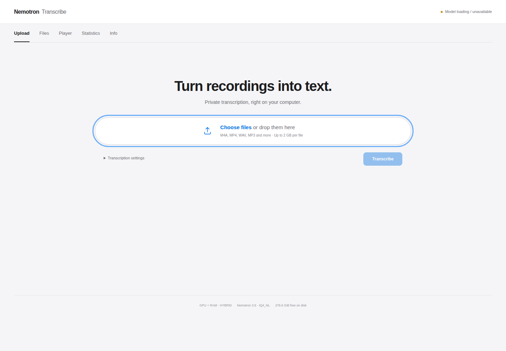
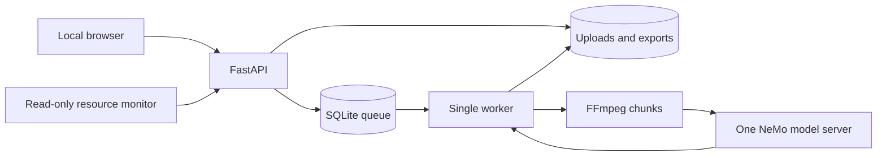

<div align="center">

# Nemotron Transcribe

### Your recordings. Your hardware. Your words.

A private transcription studio for **Nemotron 3.5 Transcribe 30B-A4B**.<br>
Built for **RTX 3080 10 GB + 64 GB RAM**, with a reproducible CPU baseline and experimental expert offloading.


[Quick start](#quick-start) · [The studio](#the-studio) · [Measured performance](#measured-performance) · [Hardware](#hardware-and-offloading) · [Operations](#operations)

</div>



## The studio

Five tabs. One local workspace.

| Tab | What you get |
| :--- | :--- |
| **Upload** | A wide, centered file chooser. M4A first, plus MP4, WAV, MP3, FLAC and more. Multiple uploads, real upload progress, and automatic navigation to the new file. |
| **Files** | A durable queue, per-file progress, elapsed time, throughput, TXT/JSON/SRT downloads and deletion controls. |
| **Player** | Audio/video beside the full transcript. Word highlighting follows real model alignment; click a word to seek, change playback speed, or disable automatic scrolling. |
| **Statistics** | Per-file and aggregate processing time, RTF and RTFx. Totals use summed audio and processing times. |
| **Info** | Deployment revisions and live host CPU/RAM, model RSS, storage and available GPU telemetry. |

**Romanian by default.** Diacritics remain intact throughout upload, transcription, playback and export. Language can also be English or automatic. Speaker labels are optional and local to each chunk.

**No invented timestamps.** If alignment is missing, invalid or partial, text remains available; synchronized highlighting and SRT are withheld for unaligned text.

## Quick start

Requirements: Linux, Docker Engine with the Compose plugin, **64 GB RAM**, and enough disk for the **21.35 GB model pair**, build layers and your recordings. Allow **at least 60 GB free** for a new setup; CUDA builds may need more.

```bash
git clone git@github.com:bogdancstrike/nemotron-transcribe.git
cd nemotron-transcribe
docker compose up --build -d
```

Open **[localhost:7860](http://127.0.0.1:7860)**.

The first explicit `docker compose up` builds the pinned runtime, downloads the exact decoder **and mandatory encoder**, verifies SHA-256 hashes, prepares writable data directories, and starts the web app, model server, worker and resource monitor. First provisioning takes time. Model weights and uploaded recordings are **never included in Git or Docker images**.

The default deployment uses the **tested RTX 3080 hybrid path**, with routed experts in system RAM. Install NVIDIA Container Toolkit and use a CUDA 13-compatible driver (tested: 580.178.04). For a GPU-independent CPU deployment, run `docker compose -f compose.yaml up --build -d`.

```bash
# Watch provisioning and model startup
docker compose logs -f model-download nemo

# Optional settings; defaults already work
cp .env.example .env
```

Existing complete model files are verified locally on subsequent starts, without contacting Hugging Face. After dependencies and weights are provisioned, transcription works offline.

## Measured performance

Measured on **Ryzen 9 9950X3D**, **64 GB RAM**, Ubuntu, using the exact IQ4_NL/F16 pair. The CPU results below use real Romanian recordings. The hybrid comparison uses the identical 60-second WAV and the same pinned model pair.

| CPU test | Result |
| :--- | ---: |
| Same 60-second news WAV, 3 sequential runs | **2.86× median RTFx** |
| Peak model process RSS across those runs | **35,589 MiB** |
| Inference process GPU allocation | **0 MiB** |
| Five additional 60-second M4A excerpts | **5/5 succeeded** |
| Median RTFx across the five excerpts | **3.16×** |

| Source recording · 60-second excerpt | Processing time | RTFx |
| :--- | ---: | ---: |
| `TpUDm4ay-B8.m4a` | 17.50 s | 3.43× |
| `oBcyZg0mNJo.m4a` | 19.00 s | 3.16× |
| `dyVQpIUe1zc.m4a` | 19.07 s | 3.15× |
| `fanN33YW3fc.m4a` | 18.81 s | 3.19× |
| `raE1bfapRhI.m4a` | 21.11 s | 2.84× |

**RTFx = audio duration ÷ processing time**; above 1× is faster than real time. **RTF = processing time ÷ audio duration**; below 1 is faster. Processing includes media preparation, model requests and export; upload, queue wait and model startup are excluded.

These five results use excerpts starting 10 seconds into each recording. They **do not establish full-recording throughput**. Full-length tests are still in progress; measured GPU results are below. WER/CER are unreported because independent reference transcripts have not been supplied. A model transcript is not a reference transcript.

### RTX 3080 hybrid proof

Three sequential 60-second Romanian requests succeeded with the patched runtime:

| Measurement | Result |
| :--- | ---: |
| Median warm model-request RTFx | **7.41×** |
| Request time | **8.07–8.12 seconds** |
| Peak model VRAM | **6,006 MiB** |
| Peak total VRAM, including desktop | **6,941 MiB** |
| Peak model process RSS | **17,034 MiB** |
| Peak GPU utilization | **100%** |

CPU inference on the same clip took about 21 seconds. The hybrid and CPU transcripts matched across all **179 normalized words**; punctuation differed. This is agreement between runtimes, **not ground-truth accuracy**. The hybrid figures exclude UI/queue/preparation time. Full-length tests are running separately.

## Hardware and offloading

| Component | Configuration |
| :--- | :--- |
| Model | NVIDIA Nemotron 3.5 Transcribe 30B-A4B |
| Decoder | `NVIDIA-Nemotron-3.5-Transcribe-30B-A4B-AD-IQ4_NL.gguf` · 19,678,656,672 bytes |
| Encoder | `NVIDIA-Nemotron-3.5-Transcribe-30B-A4B-Encoder-F16.gguf` · 1,670,410,080 bytes |
| Runtime | NVIDIA/NeMo-Speech.cpp, pinned to `20999cc921d2b14aa58708f61756a8b2e787ba20` |
| Model snapshot | `dbd06c5cad7a2f33c8e06be2fb3ef814dbd9aa59` |
| Target GPU | RTX 3080 · 10 GB · compute capability 8.6 |
| Concurrency | One model server, one host worker, one decode slot |

The complete decoder and encoder do not fit in 10 GB VRAM. Stock NeMo-Speech.cpp does not expose the required CPU expert-placement setting. The local Apache-2.0 patch introduces `asr.salm.n_cpu_moe`, uses llama.cpp's existing CPU expert tensor helper, enables memory mapping, and selects the standard mixed-device scheduler for the Mamba/Transformer decoder.

`n_cpu_moe: 48` means routed-expert weights in the **first 48 decoder block indices**, not “48 MoE layers.” Attention, Mamba, router, shared-expert and encoder tensors retain their default GPU placement. Speculative decoding is disabled.

**Default GPU launch** — requires NVIDIA Container Toolkit and a compatible driver:

```bash
docker compose up --build -d
```

The corrected patch passed three successive real-model requests on the target GPU. Full-length soak tests and independent Romanian accuracy evaluation remain open. Inspect [runtime.lock.json](runtime.lock.json), the [patch](runtime/hybrid.patch), and [runtime attribution](runtime/NOTICE.md) for exact provenance.

## Operations

```bash
# Logs and service state
docker compose ps
docker compose logs -f worker web

# Restart services; uploads and finished exports remain on disk
docker compose restart

# Stop the stack without deleting recordings or weights
docker compose down
```

Files live in `./data`; models live in `./models`. Neither directory is tracked. Keep the same data directory across restarts. A host lock prevents a second worker from recovering active jobs. Completed segments are checkpointed atomically. After a worker restart, compatible checkpoints resume at the first unfinished segment. A changed backend or transcription setting starts a fresh run. The Files tab offers **Retry** for failed or completed recordings. An engine disconnect waits for recovery before safely resuming; uncertain live-request timeouts fail clearly instead of submitting duplicates.

The UI binds only to **127.0.0.1**. The inference service has **no published host port**. This is a single-user local tool; public access needs a real authentication/reverse-proxy design.

Limits are configurable in `.env.example`: upload size, recording duration, disk reserve, queue size and retention. Retention is off by default. Deleting a queued or completed file removes its upload and derived artifacts; active files cannot be deleted.

## Tests and benchmarks

```bash
uv venv .venv
uv pip install --python .venv/bin/python -r app/requirements.txt pytest pyyaml psutil
.venv/bin/pytest -q

# Real-model performance through the upload/job/download API
.venv/bin/python scripts/benchmark.py your-recording.m4a \
  --output evidence/my-benchmark --segment-seconds 60

# Add --reference reference.txt to compute Romanian WER/CER.
```

The application suite currently passes **38 tests**, including checkpoint recovery, failed/completed-file retries, model-disconnect recovery, actual FFmpeg conversion of a synthetic 60-minute MP4, queue recovery and locking, Unicode exports, byte-range playback, invalid alignment, bounded retries and OOM handling. That long-file test uses mocked inference. Browser checks separately exercise the real aligned player, upload navigation and mobile layout. Raw local evidence is stored under `evidence/` and excluded from Git because it can contain recordings and transcripts.

## Architecture



## Sources and licenses

Model: [NVIDIA official checkpoint](https://huggingface.co/nvidia/NVIDIA-Nemotron-3.5-Transcribe-30B-A4B). Community GGUF pair: [AtomicChat](https://huggingface.co/AtomicChat/NVIDIA-Nemotron-3.5-Transcribe-30B-A4B-GGUF). Runtime: [NVIDIA/NeMo-Speech.cpp](https://github.com/NVIDIA/NeMo-Speech.cpp).

Runtime source follows **Apache-2.0**; ggml/llama.cpp and other components retain their notices in the runtime image. Model weights follow **OpenMDW License 1.1**. See [runtime/NOTICE.md](runtime/NOTICE.md) and upstream model terms before redistribution.
