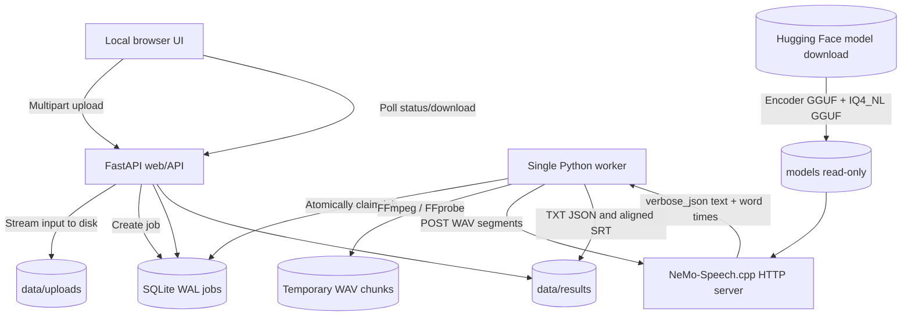

# Architecture and dataflow

## Logical components

### Service boundaries

`model-download` is an explicit, setup-only ephemeral service using huggingface_hub. It downloads only the selected decoder plus the mandatory speech encoder.

`nemo` is an upstream model server, isolated on an internal Docker network. Reference implementation is CPU-only. GPU+CPU hybrid is a separate experimental runtime build and should have a **capability check** at startup.

`web` is a single FastAPI process for uploads, jobs and downloading artifacts; static HTML/JS UI. `worker` is separately deployed to avoid blocking HTTP while transcribing. Both access persistent `/data` volume and SQLite WAL DB.

### SQLite job schema

`id`, `filename`, `input_path`, `status`, `language`, `segment_seconds`, `diarize`, `progress`, `total_segments`, `completed_segments`, `error`, `created_at`, `updated_at`.

`queued -> preparing -> processing -> done|failed`; worker startup recovers in-flight jobs into queue (currently restarts whole job; per-chunk checkpointing is future work). `claim_job()` must be transactionally atomic; single worker enforced by deployment.

### Audio processing

- File allowlist plus `ffprobe` to verify actual decodable audio stream; FFmpeg command arguments always a list, never a shell string.
- Encode signed PCM16, mono, 16,000 Hz; segment durations targeted at 60/120/300s.
- Each model request is sent with language code if user supplied one, and `response_format=verbose_json` to ask for aligned words.
- Each segment has an actual media timeline start offset and a local transcript. Add offset to each returned word start/end when producing global timestamps.
- Track actual segment durations using FFprobe and cumulative offsets; never blindly assume exact muxer cut boundaries across hours.
- Speaker IDs may reset at segment boundaries. Include `speaker_scope=chunk` in JSON metadata until an explicit speaker stitching algorithm is implemented.

### Failure handling

- Model unavailable => job waits with visible engine not-ready state. HTTP 400/413/422 => terminal failure; HTTP 429/5xx/network => bounded retries with backoff.
- Crash/restart => queued/preparing/processing jobs recover; ensure no lost uploaded inputs.
- Out-of-memory => fail job and alert, do not retry every chunk forever. Resume only after lowering context/batching or changing backend.
- Word timestamps unavailable => text/JSON still available; do not assert precise SRT timing.

### Performance

Single model instance, one effective inference request and conservative context. The web/API should remain responsive while the worker uses CPU. Model Q4 decoder = 19.68 GB, encoder = 1.67 GB (decimal storage); runtime caches and intermediate buffers are additional. CPU host RAM is shared with browser, Docker and OS. Use actual metrics rather than an advertised 1-hour throughput number.
